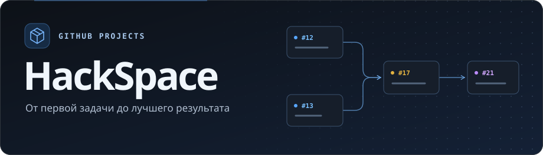
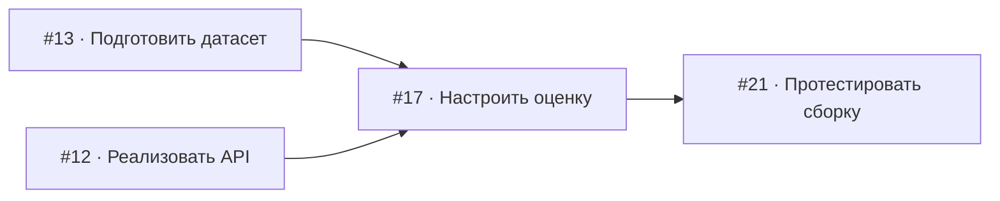

<div align="center">
  

  <p><strong>Что взять сейчас, что блокирует работу и стала ли сборка лучше?</strong></p>
  <p>HackSpace дополняет GitHub Projects доской задач, графом зависимостей, схемой репозитория и историей замеров.</p>
  <p>
    <a href="#demo">Попробовать демо</a> ·
    <a href="#setup">Подключить проект</a> ·
    <a href="#development">Разработка</a> ·
    <a href="docs/PLAN.md">План MVP</a>
  </p>
</div>

## Возможности

| Вкладка | Что в ней |
| --- | --- |
| **Задачи** | Kanban только для Issues. Перетаскивайте карточки между колонками GitHub Project; открывайте связанные PR прямо из карточек. |
| **Pull Requests** | Все PR репозитория, даже без связанной задачи: авторы, статусы, решения по ревью, ветки и время обновления. Фильтр «Запрошено моё ревью» показывает личные запросы, время ожидания при наличии даты и ссылки на связанные задачи доски. |
| **План задач** | Граф слева направо в духе Obsidian Canvas: независимые задачи идут параллельно, на карточках видны исполнители и связанные PR. |
| **Архитектура** | Постройте схему компонентов для конкретного коммита основной ветки. Можно добавить комментарий, чтобы подсказать DeepSeek, на чём сделать акцент. Схема ссылается на исходники. |
| **Результаты** | Внесите балл внешнего теста от 0 до 100. График покажет, как менялся результат со временем; каждый замер связан с коммитом, в том числе повторные тесты. |

GitHub остаётся источником правды для задач, статусов и зависимостей. HackSpace хранит схемы и замеры отдельно. Сервис рассчитан на **один Project организации и один репозиторий на экземпляр**. Он не запускает тесты или CI, не сливает PR и не редактирует зависимости.

Во вкладке **Результаты** выберите набор тестов и версию, чтобы увидеть график и изменение балла относительно предыдущего замера этой серии. В истории нажмите **Выбрать для демо**, чтобы сохранить общий для команды коммит, ссылку на стенд и причину выбора. Старые замеры доступны в группе «Без данных о наборе».

Чтобы агенты работали по правилам команды, добавьте текст шаблона в корневой `AGENTS.md` репозитория хакатона, сохранив его действующие инструкции. [Промпт для ведущего агента и исполнителей](docs/HACKSPACE_AGENT_PROMPT.md)

<details>
<summary><strong>Пример плана: две задачи можно делать параллельно</strong></summary>



При снятии последней зависимости исполнитель видит уведомление со ссылкой на задачу. Активная вкладка сверяет доску каждые две минуты. История наблюдений и отметки о прочтении хранятся в этом браузере.

Стрелка идёт **от блокера к зависимой задаче**. Открытая задача в колонке `Done` или «Готово» снимает блокировку внутри проекта. Сам Issue остаётся открытым.

</details>

<a name="demo"></a>

## Быстрый старт: локальное демо

Ключи, GitHub App и PostgreSQL для демо не нужны. Если установлен **Docker с Compose**, из корня репозитория выполните:

```sh
docker compose up --build
```

<details>
<summary>Запуск без Docker (Node.js 22.18+)</summary>

```sh
npm ci
cp .env.example .env.local
npm run dev -- --webpack --hostname 127.0.0.1
```

</details>

Откройте **<http://localhost:3000>**. Попробуйте перенести карточку, открыть «План задач» и добавить замер, указав SHA из вкладки «Результаты». Генерация схемы в демо имитируется: файлы никуда не отправляются, а изменения сбрасываются после перезапуска.

Для остановки контейнера выполните `docker compose down`.

<a name="setup"></a>

## Подключение своего проекта

Понадобятся PostgreSQL, репозиторий и GitHub Project одной организации. Для генерации схемы также нужен ключ DeepSeek; без него остальные вкладки работают.

### 1. Создайте GitHub App

- В [настройках GitHub App](https://docs.github.com/en/apps/creating-github-apps/registering-a-github-app/registering-a-github-app) укажите callback `<APP_URL>/api/auth/callback`. Оставьте включёнными истекающие пользовательские токены. Webhooks не нужны; авторизация запускается кнопкой «Войти через GitHub».
- Установите приложение в организации, выбрав нужный репозиторий. Используйте **Client ID** и **Client Secret** приложения, а не App ID или персональный токен.

| Область | Разрешение GitHub App | Доступ |
| --- | --- | --- |
| Organization | Projects | Read and write |
| Repository | Issues, Pull requests, Contents | Read-only |

Участнику нужны доступ к проекту и явный доступ к репозиторию. Для переноса карточек, добавления замеров и генерации схемы нужно право записи в Project. При истечении сессии войдите снова.

### 2. Настройте окружение

Для Docker скопируйте [`.env.docker.example`](.env.docker.example) в `.env.docker`. Для запуска через npm используйте [`.env.example`](.env.example) и `.env.local`.

| Переменные | Что указать |
| --- | --- |
| `HACKSPACE_DEMO` | `0` при запуске через npm. Compose переключает режим сам. |
| `APP_URL` | Адрес, по которому пользователи открывают приложение, без пути. Для общего сервиса нужен HTTPS; локально допускается HTTP на loopback. |
| `SESSION_SECRET` | Случайный секрет: `openssl rand -base64 32`. |
| `POSTGRES_PASSWORD` | Для Docker: пароль PostgreSQL без специальных символов URL, например вывод `openssl rand -hex 32`. Compose сам формирует URL базы. |
| `DATABASE_URL` | Только при запуске через npm: URL вашей PostgreSQL-базы. |
| `GITHUB_CLIENT_ID`, `GITHUB_CLIENT_SECRET` | Данные GitHub App. |
| `GITHUB_OWNER`, `GITHUB_REPO`, `GITHUB_PROJECT_NUMBER` | Организация, имя репозитория без организации и номер из URL `/orgs/<owner>/projects/<number>`. |
| `DEEPSEEK_API_KEY`, `DEEPSEEK_MODEL` | Необязательные настройки генерации. По умолчанию `deepseek-flash`; альтернатива — `deepseek-v4-pro`. |
| `ALLOW_PRIVATE_DEEPSEEK` | По умолчанию `0`. Установите `1`, только если команда разрешила передачу файлов непубличного репозитория в DeepSeek. |

> [!IMPORTANT]
> Не публикуйте `.env.docker`, `.env.local`, ключи и секреты. Перед запуском участник подтверждает список файлов для зафиксированного SHA. Если заполнить комментарий, он тоже отправится в DeepSeek — не добавляйте туда секреты. Фильтрация чувствительных файлов не заменяет проверку списка.

### 3. Запустите приложение

**Через Docker Compose**:

```sh
docker compose --env-file .env.docker -f compose.yaml -f compose.project.yaml up --build -d
```

Compose поднимет PostgreSQL, применит схему и только потом запустит приложение и воркер. Данные PostgreSQL сохраняются в томе `postgres-data` после обычного `down`; база не публикует порт на хосте. Приложение слушает порт 3000 только на loopback хоста. Для общего сервиса поставьте перед ним HTTPS-прокси и укажите внешний адрес в `APP_URL` и в callback GitHub App.

```sh
docker compose --env-file .env.docker -f compose.yaml -f compose.project.yaml down
```

<details>
<summary>Запуск через npm вместо Docker</summary>

Создайте пустую PostgreSQL-базу и выполните:

```sh
npm ci
npm run db:migrate
npm run build
npm start
```

Для генерации схем запустите **отдельный процесс** с теми же настройками:

```sh
npm run worker
```

</details>

Начните с тестового Project: перенесите карточку из HackSpace и проверьте новый статус в GitHub. Затем проверьте, что участник с доступом только на чтение не может изменить статус.

> [!NOTE]
> Подсказка «Можно брать» на плане задач опирается на данные GitHub. Если API сигнализирует, что зависимости видны не полностью, HackSpace не предлагает задачу к выполнению. Если GitHub скрывает блокер без такого сигнала, HackSpace не может его обнаружить.

<a name="development"></a>

## Разработка

**Стек:** Next.js, TypeScript, PostgreSQL, React Flow и Dagre.

```sh
npm test
npm run typecheck
npm run build
```

Тест очереди генерации запускается при заданном `HACKSPACE_TEST_DATABASE_URL`. Используйте отдельную тестовую базу с применённой [схемой](db/schema.sql).

| Где искать | Что там |
| --- | --- |
| [`app/`](app/) и [`components/`](components/) | Интерфейс и HTTP API. |
| [`lib/pipeline.ts`](lib/pipeline.ts) | Порядок задач, циклы и готовность к работе. |
| [`lib/github.ts`](lib/github.ts) | Авторизованные запросы к GitHub. |
| [`scripts/worker.ts`](scripts/worker.ts) | Фоновое построение схемы. |

Есть идея или нашли ошибку? Откройте Issue. Для бага укажите режим (демо или GitHub), шаги воспроизведения и ожидаемый результат. Для изменений, затрагивающих несколько вкладок или права доступа, лучше сначала обсудить подход в Issue.

## Лицензия

Проект распространяется по [лицензии MIT](LICENSE).
